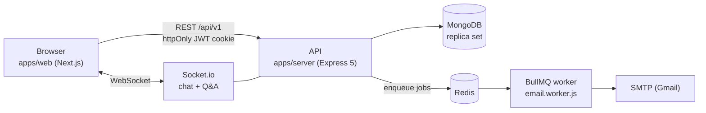

# EdSync

[](https://github.com/muhammadsarim11/EdSync/actions/workflows/ci.yml)

A multi-tenant B2B cohort and mentorship platform. Independent creators and institutes each get an
isolated tenant to run live cohorts, structure curriculum (Cohort → Module → Lecture), grade
assignments, and collaborate in real time with chat and Q&A.

This is a monorepo: the Next.js web app and the Express API live side by side, share one lockfile,
and are checked by one CI pipeline.

## Repository layout

```
.
├── apps/
│   ├── web/              # Next.js (App Router) + TypeScript + Tailwind + shadcn/ui
│   └── server/           # Express 5 API + Socket.io + BullMQ worker, MongoDB via Mongoose
├── docs/
│   └── API.md            # Full REST + Socket.io reference
├── docker-compose.yml    # Local Redis + single-node MongoDB replica set
├── package.json          # npm workspaces root
└── .github/              # CI (path-filtered per app) + Dependabot
```

Each app has its own README with the details:

- [`apps/web`](apps/web/README.md): pages, auth rehydration, API client, cross-domain cookie notes
- [`apps/server`](apps/server/README.md): architecture, tenancy/auth model, env vars, background
  jobs, security, testing

## Architecture



- **Multi-tenancy:** every institute is an `Organization`; every tenant-scoped query and index is
  keyed on `organizationId`, which is embedded in the JWT so it can't be spoofed per request.
- **RBAC:** role checks (`restrictTo`) sit in the route layer on the API, and the web app mirrors
  them with role-gated layouts (`require-role.tsx`). The API is the source of truth.
- **Async work:** slow side effects (verification, invite, and notification emails) go through a
  BullMQ queue so a request never waits on SMTP. A dead Redis never turns a successful DB write
  into a 500.
- **Real-time:** Socket.io handles cohort chat and Q&A next to the REST API, authenticated with the
  same session cookie.

## Getting started

Requirements: Node.js 20+ (CI uses 24), Docker (for local Redis and MongoDB).

```bash
npm install                       # installs both apps (npm workspaces)
docker compose up -d              # Redis + a single-node MongoDB replica set on :27018

cp apps/server/.env.example apps/server/.env          # fill in real values
cp apps/web/.env.local.example apps/web/.env.local

npm run dev:server                # API on http://localhost:5000
npm run dev:worker                # email worker, in a second terminal
npm run dev:web                   # web app on http://localhost:3000
```

MongoDB must be a replica set (invite acceptance uses a multi-document transaction). The compose
file sets that up; Atlas free tier works too.

## Scripts (from the repo root)

| Script                 | What it does                                    |
| ---------------------- | ----------------------------------------------- |
| `npm run dev:web`      | Next.js dev server                              |
| `npm run dev:server`   | API with nodemon                                |
| `npm run dev:worker`   | BullMQ email worker with nodemon                |
| `npm run build`        | Production build of the web app                 |
| `npm test`             | API test suite (Vitest + Supertest, real Mongo) |
| `npm run lint`         | ESLint in every workspace                       |
| `npm run format:check` | Prettier check in every workspace               |

Any workspace script can also be run directly, e.g. `npm run test:watch -w @edsync/server`.

## Deployment

The two apps deploy independently from this one repo:

- **Web → Vercel:** set the project's Root Directory to `apps/web`; Vercel detects the npm
  workspace and installs from the root lockfile.
- **API → Render:** set the service's Root Directory to `apps/server`, build command
  `npm ci`, start command `npm start` (and a second background worker running `npm run worker`).

## Git history

Both apps keep their full commit history. The API was developed in this repository (originally
under `server/`); the web app was developed in a separate `edsync-client` repository and imported
here with every commit preserved under `apps/web/`, so `git log -- apps/web` and `git blame` work as
if it had always lived here.

## Branching

GitHub Flow: `main` is always deployable; work happens on short-lived `feat/`, `fix/`, `chore/`
branches merged back with `--no-ff`.
